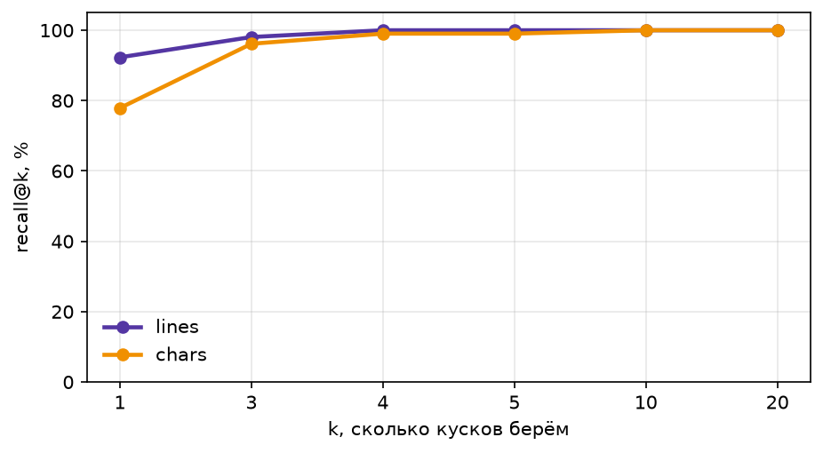
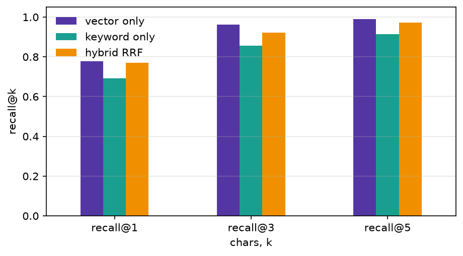
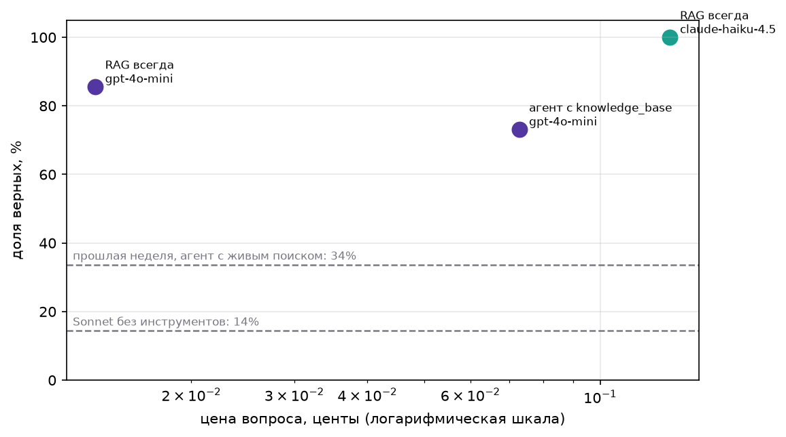
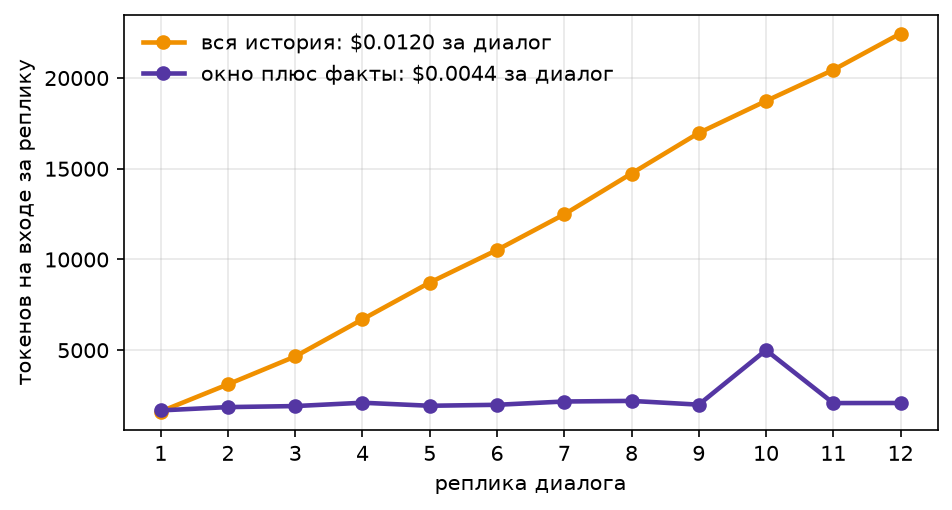

  # Домашка 2: база знаний по матчам ЧМ-2026

Корпус и вопросы те же, что в первой домашке: 104 матча чемпионата мира 2026 года по статьям английской Википедии.
Здесь знания лежат в Milvus, а модель получает несколько нужных кусков вместо живого поиска по Википедии.

| Файл | Что делает |
| --- | --- |
| [load_index.py](load_index.py) | нарезка, эмбеддинги с кэшем, индекс в Milvus, recall@k, гибрид, инструмент `knowledge_base` |
| [test_knowledge_base.py](test_knowledge_base.py) | тесты инструмента без вызова модели |
| [main.py](main.py) | `rag_answer`, агент с `knowledge_base`, прогон трёх конфигураций, `report`, `money_chart`, отказы, разбор провалов |
| [memory.py](memory.py) | эпизодическая и семантическая память агента, демонстрация трёх сессий, замер токенов `memory_tokens` |
| [test_memory.py](test_memory.py) | тесты записи и поиска фактов без вызова модели |

## 1. Исходные данные для кусков

Данные собраны скриптами первой домашки ([01_ReAct](../01_ReAct/README.md)):

1. `extract_match_links.py` берёт из статьи `2026_FIFA_World_Cup` ссылки на все матчи: 104 URL с якорем матча.
2. `extract_match_descriptions.py` скачивает страницы групп и плей-офф и по якорю вырезает секцию матча. В тексте три
   части, каждая с новой строки:
   - `footballbox`: дата, счёт, авторы голов, стадион, посещаемость, судья;
   - абзацы прозы: история встреч, рекорды, удаления, происшествия;
   - таблицы составов и судейской бригады, каждая таблица одной строкой.

Результат лежит в [data/match_descriptions.jsonl](data/match_descriptions.jsonl): 104 строки, 256 тысяч символов.
По сравнению с первой домашкой добавлены два поля метаданных, оба выводятся из URL:

| Поле | Откуда | Пример |
| --- | --- | --- |
| `url` | ссылка на секцию матча | `https://en.wikipedia.org/wiki/2026_FIFA_World_Cup_Group_A#Czech_Republic_vs_South_Africa` |
| `stage` | название статьи | `2026 FIFA World Cup Group A` |
| `match` | якорь | `Czech Republic vs South Africa` |
| `text` | текст секции | |

Стадий 14: двенадцать групп по 6 матчей, `round of 32` и `knockout stage` по 16. Каждый кусок наследует `stage`,
`match` и `url`, поэтому по любому куску человек найдёт источник, а поиск можно ограничить одной стадией.

Вопросы тоже из первой домашки: [data/match_quiz_evaluated.jsonl](data/match_quiz_evaluated.jsonl), 104 штуки, по
одному на матч. У каждого есть `answer`, `evidence` (цитата из описания) и результаты прошлой недели: `sonnet_ok`
(сильная модель без инструментов) и `agent_ok` (дешёвая модель с живым поиском).

## 2. Две нарезки

Обе нарезки в [load_index.py](load_index.py) сохраняются в `data/chunks_<mode>.jsonl` и в коллекции Milvus
`chunks_<mode>`.

| Нарезка | Функция | Кусков | Длина, символов (мин / средн / макс) |
| --- | --- | --- | --- |
| по строкам | `chunk_lines` | 635 | 41 / 402 / 1438 |
| по 400 символов | `chunk_chars` | 693 | 1 / 369 / 400 |

**`chunk_chars`** склеивает описание в одну строку и режет ровно по 400 символов, не глядя на смысл. Факты рвутся
пополам. Ответ на первый же вопрос (`fresh-0`, судейская тройка из США) разрезан так:

```
кусок 1: ...This was the only match in Group A held outside of Mexico. By officiating this match, referees
кусок 2:  Tori Penso , Brooke Mayo , and Kathryn Nesbitt became the second all-female on-...
```

**`chunk_lines`** режет по границам, которые уже есть в описании: одна непустая строка — один кусок. Строка здесь
законченная единица смысла: `footballbox` целиком, абзац прозы или таблица состава. Факт внутри строки не рвётся, а
длина куска остаётся небольшой: в среднем 400 символов, как у наивной нарезки. Строки короче 40 символов отдельным
куском не идут, а приклеиваются к следующей длинной строке. Таких строк 122, почти все это заголовки над таблицей
состава (`Tunisia [ 24 ] Japan [ 24 ]`) и фраза `The two teams had never met before.` перед абзацем. Отдельно они
бесполезны и только засоряют выдачу, а рядом со своей таблицей или абзацем дают им контекст.

В эмбеддинг и в поиск по словам кусок идёт с приставкой `stage | match:` (`emb_text`). Иначе кусок из середины
описания, например таблица состава, не знал бы, о каком матче он.

## 3. Вопросы без ответа

[data/match_quiz_unanswerable.jsonl](data/match_quiz_unanswerable.jsonl): 10 вопросов в том же формате, что и основные.
У них `source: "unanswerable"`, `answer: "NOT_FOUND"`, пустые `evidence` и `url`. Все по теме турнира, но о том, чего
нет в секциях матчей:

- награды: «Золотой мяч», «Золотая перчатка», приз Fair Play;
- деньги и организация: призовые Испании, цена самого дешёвого билета на финал, шоу в перерыве финала, базовый лагерь Испании;
- события после турнира: новые главные тренеры Южной Кореи и Португалии;
- статистика, которой нет в `footballbox`: владение мячом в финале.

`main.py` гоняет их вместе с основными вопросами. Правильное поведение на них: ответ `NOT_FOUND`.

## 4. Эмбеддинги

- Модель `openai/text-embedding-3-small` через OpenRouter, укороченный вектор на 512 измерений (`dimensions=512`).
- Кэш на диске: [emb_cache.npz](emb_cache.npz). Ключ — `sha1` от эмбеддируемого текста, значение — вектор, хранится
  во `float16`, сейчас там 1762 вектора: куски обеих нарезок, вопросы и запросы агента. `embed_cached` считает через
  API только то, чего нет в кэше, пачками по 64 текста. Повторный запуск `load_index.py` стоит $0.
- Векторы вместе с метаданными и текстом кусков лежат в Milvus. Данные базы лежат в `./index`, это том контейнера из
  [docker-compose.yml](docker-compose.yml). В коллекции поля `vector` (COSINE), `doc` с английским анализатором и
  `sparse` (BM25-функция Milvus над `doc`), остальные поля динамические.

## 5. recall@k и выбор k

`recall@k` — доля вопросов, у которых хотя бы один верный кусок попал в первые k результатов векторного поиска. Кусок
считается верным (`is_gold`), если он из того же матча (`url` совпадает) и в нём есть нормализованный эталонный ответ.
Совпадение текста с `evidence` не требуем: цитаты в квизе пересказаны моделью, а не скопированы.



| k | по строкам | по 400 символов |
| --- | --- | --- |
| 1 | **0.92** | 0.78 |
| 3 | 0.98 | 0.96 |
| 4 | 1.00 | 0.99 |
| 5 | 1.00 | 0.99 |
| 10 | 1.00 | 1.00 |
| 20 | 1.00 | 1.00 |

Нарезка по строкам выигрывает там, где это важнее всего, на первом месте выдачи: 0.92 против 0.78. К k=3 разрыв почти
закрывается, потому что разорванный факт находится по одной из половин.

**Выбор для прогона: нарезка по строкам, чистый векторный поиск, k = 5.** Кривая выходит на 1.00 уже при k=4, пятый
кусок оставляет запас на вопросы, где поиск отличается от тестового. Пять кусков по 400 символов — это около 500
токенов контекста, дальше контекст только дорожает, а recall уже не растёт.

## 6. Гибридный поиск

Проверен на нарезке по 400 символов, где вектору тяжелее всего. Поиск по словам — BM25 внутри Milvus по тому же тексту
`stage | match: text`, запросом служит сырой текст вопроса. Слияние рангов — RRF с K=60 (`rrf` в
[load_index.py](load_index.py)).



| поиск | recall@1 | recall@3 | recall@5 |
| --- | --- | --- | --- |
| только вектор | **0.78** | **0.96** | **0.99** |
| только слова (BM25) | 0.69 | 0.86 | 0.91 |
| гибрид RRF | 0.77 | 0.92 | 0.97 |

**Вывод: на этом корпусе гибрид не помогает, при любом k он немного хуже чистого вектора.** RRF складывает два списка
с равным весом, а список BM25 заметно слабее и тянет результат вниз. Скорее всего, причина в самих вопросах. Каждый
вопрос называет обе команды и стадию, а эти слова есть в каждом куске матча (приставка `stage | match`) и в кусках
других матчей тех же команд. Поиск по словам находит нужный матч, но не нужный кусок внутри него, а ответа в вопросе
по построению нет, и редкого точного слова, на котором BM25 обычно выигрывает, у него нет. Поэтому `knowledge_base`
и `rag_answer` используют чистый векторный поиск по нарезке по строкам.

## 7. RAG против агента: прогон, отказы, провалы

### Как устроены вызовы LLM

Все вызовы идут через OpenRouter с `temperature=0`. Цену каждого вызова берём из поля `usage.cost` ответа и пишем в
журнал `logs/ledger.jsonl`. Модели: дешёвая `openai/gpt-4o-mini`, средняя `anthropic/claude-haiku-4.5`.

- **`rag_answer`, «RAG всегда».** Перед каждым ответом ищем 5 ближайших кусков в `chunks_lines`, кладём их в промпт
  пронумерованными (`[2] (stage / match) text`) и делаем один вызов. Системный промпт: отвечать только по источникам,
  ссылаться на номер источника, при отсутствии ответа писать ровно `NOT_FOUND`, последней строкой `FINAL: <короткий ответ>`.
- **`agent`, «агент с `knowledge_base`».** Модель сама решает, искать ли и что искать. У инструмента есть схема
  (`KB_SCHEMA` из pydantic-модели `KBArgs`) и описание. Параметры: `query` (короткий запрос на английском) и
  необязательный `stage`, который принимает только одну из 14 реальных стадий или пустую строку. Агент делает до 6
  шагов. Повторный одинаковый вызов останавливает цикл, после чего модель отвечает по тому, что уже нашла.
- **Тест инструмента** — [test_knowledge_base.py](test_knowledge_base.py): ответ находится, фильтр по стадии
  возвращает куски только этой стадии, по несуществующей стадии возвращается `nothing found`. Ещё два теста проверяют
  схему: `stage` необязателен, а выдуманную стадию схема отвергает.
- **Проверка ответа** (`is_correct` в [main.py](main.py)). Берём строку после `FINAL:` и нормализуем её и эталон:
  нижний регистр, без диакритики и артиклей, числительные и порядковые числительные в цифры (`sixth` → `6`), `88'` →
  `88 minute`, `64,478` → `64478`. Ответ верный, если в нём есть все слова эталона. Отказ засчитывается, если в ответе
  есть `NOT_FOUND`.

Каждая конфигурация отвечает на все 114 вопросов (104 с ответом и 10 без). Ответы сохраняются в
`data/eval_results.jsonl` вместе с найденными кусками. Повторный `python main.py` пересчитывает таблицы бесплатно,
`--rerun <конфигурация>` спрашивает модель заново.

### Результаты

Считаем по 104 вопросам с ответом. «Цена вопроса» — средняя цена одного вопроса, «цена верного» — цена вопроса,
делённая на долю верных.

| конфигурация | модель | доля верных | цена вопроса | цена верного ответа |
| --- | --- | --- | --- | --- |
| RAG всегда | gpt-4o-mini | 85.6% | $0.000137 | **$0.000160** |
| агент с knowledge_base | gpt-4o-mini | 73.1% | $0.000727 | $0.000995 |
| RAG всегда | claude-haiku-4.5 | **100%** | $0.001317 | $0.001317 |



Пунктиром на графике результаты первой недели на тех же вопросах, из полей `agent_ok` и `sonnet_ok`: агент с живым
поиском по Википедии ответил на 34%, Sonnet без инструментов на 14%.

- **Дешёвая модель с RAG** даёт самый дешёвый верный ответ, в 8 раз дешевле средней модели, ценой 14 п.п. точности.
- **Средняя модель с RAG** ответила верно на все 104 вопроса. При recall@5 = 1.00 весь потолок определяет модель, а не поиск.
- **Агент** проигрывает «RAG всегда» на той же модели и по точности (73% против 86%), и по цене: вопрос в 5 раз
  дороже. Агент делает в среднем 2.1 поиска на вопрос, и найденное на каждом шаге тянется в контекст следующего.
  Отсюда около 1650 токенов на вход за вызов против 780 у RAG. При этом выбирает запрос он хуже, чем простой поиск по
  тексту вопроса: см. разбор провалов ниже.

цена верного ответа снизилась заметно, например, для claude-haiku-4.5 на порядок

### Отказы

| конфигурация | модель | честно отклонил (из 10 без ответа) | отклонил зря (из 104 с ответом) |
| --- | --- | --- | --- |
| RAG всегда | gpt-4o-mini | 10 / 10 | 12 / 104 |
| агент с knowledge_base | gpt-4o-mini | 10 / 10 | 21 / 104 |
| RAG всегда | claude-haiku-4.5 | 10 / 10 | 0 / 104 |

Все три конфигурации честно отказываются на всех 10 вопросах без ответа. Различаются они зря отклонёнными вопросами:
у дешёвой модели это основной источник ошибок, у Haiku таких нет.

### Разбор провалов

Лучшая конфигурация — Haiku с RAG. Ошибки делим на две кучки. «Поиск не нашёл»: среди кусков в контексте нет верного
(`is_gold`). «Нашёл, но ответ неверный»: верный кусок был, а ответ не засчитан.

| конфигурация | поиск не нашёл | нашёл, но ответ неверный |
| --- | --- | --- |
| RAG всегда, claude-haiku-4.5, **до исправления проверки** | 0 | 6 |
| RAG всегда, claude-haiku-4.5 | 0 | 0 |
| RAG всегда, gpt-4o-mini | 0 | 15 |
| агент с knowledge_base, gpt-4o-mini | 21 | 7 |

В первом прогоне у Haiku было 6 ошибок, все из кучки «нашёл, но ответ неверный». Первый пример — из них. Кучка «поиск
не нашёл» у RAG пуста при любой модели, потому что recall@5 = 1.00. Поэтому второй пример взят у агента, единственной
конфигурации, где поиск промахивается.

**Пример 1. Нашёл, но ответ неверный. Haiku с RAG, `fresh-1`. Что менять: проверку ответа.**

- Вопрос: *What FIFA World Cup milestone was reached in the Tunisia vs Japan group stage match?* Эталон: `1,000th World Cup match`.
- Контекст: все 5 кусков из секции `Tunisia vs Japan`, первый из них содержит ответ дословно: *This fixture was the
  1,000th World Cup match, with the previous milestone (900th) having been reached in the 2018 FIFA World Cup final.*
- Ответ модели: `FINAL: The Tunisia vs Japan group stage match was the 1,000th FIFA World Cup match.`

Модель ответила верно, ошиблась проверка. Старая `is_correct` искала эталон в ответе подстрокой, и одно лишнее слово
`FIFA` в середине её ломало. Остальные пять «ошибок» Haiku устроены так же: `6` при эталоне `sixth`, `14` при `fourteen`,
`88th minute` при `88'`, лишнее слово `FIFA` в `3,000th goal in tournament history`. Проверку исправили: числительные и
минуты приводятся к одному виду, а ответ засчитывается, если в нём есть все слова эталона в любом порядке. После этого
у Haiku 104 из 104. Все изменившиеся оценки проверены вручную, ни один ответ не стал верным зря.

**Пример 2. Поиск не нашёл. Агент на gpt-4o-mini, `fresh-1`. Что менять: запрос.**

- Тот же вопрос про Tunisia vs Japan (группа F).
- Контекст: агент вызвал `knowledge_base` с фильтром `stage = "2026 FIFA World Cup Group D"` и получил 5 кусков из
  группы D: составы Australia vs Turkey и Turkey vs United States, судейские бригады, `footballbox` матча Australia vs
  Turkey. Ни одного куска о нужном матче.
- Ответ модели: *I couldn't find specific information about a milestone...* `FINAL: NOT_FOUND`.

Модель не знает, в какой группе играл матч, но угадывает группу и ставит фильтр, который отрезает правильный ответ.
В первом прогоне было хуже: `stage` был свободной строкой, агент выдумывал несуществующую стадию
`2026 FIFA World Cup Group Stage` и на 17 вопросах из 104 получал пустую выдачу. Ограничение `stage` списком реальных
стадий подняло агента с 59.6% до 73.1%, но угадывание группы осталось. Следующие шаги:
убрать `stage` из инструмента, фильтровать по названию матча, которое есть в каждом вопросе, или повторять поиск без
фильтра, если в выдаче нет команд из вопроса.

**Для сравнения: настоящая ошибка модели.** Дешёвая модель с RAG, `fresh-38`: *Which Belgium player received a red
card in the group stage match between Belgium and Iran?* Эталон: `Nathan Ngoy`. Первый источник в контексте кончается
словами *...with Nathan Ngoy being sent off with a straight red card for his reckless tackle*, но gpt-4o-mini ответила
`NOT_FOUND`. Поиск отработал идеально, ошиблась модель: ответ стоит в конце длинного абзаца про другое (ничья 0:0,
лучший игрок матча). Haiku на том же контексте отвечает верно. Что менять: промпт, например попросить модель прочитать
каждый источник до конца перед отказом, или нарезку, чтобы длинный абзац делился по предложениям. Из 12 зря
отклонённых вопросов у gpt-4o-mini надо ещё проверить, сколько устроены так же.

## 8. Память

Память получает агент из шага 3: та же функция `agent` из [main.py](main.py) с инструментом `knowledge_base` и
дешёвой моделью `gpt-4o-mini`. Меняются только системный промпт (`CHAT_SYSTEM`: отвечать на языке пользователя, на
приветствия не искать) и то, какие прошлые реплики идут в контекст. Всё остальное в [memory.py](memory.py).

- **Эпизодическая память.** Журнал всех реплик `logs/episodes.jsonl`, в каждой строке `session`, `time`, `role`,
  `text` (`remember_episode`). В контекст журнал не идёт. Читается один раз, в конце сессии: из него собирается
  диалог для извлечения фактов (`end_session`).
- **Семантическая память.** Факты о пользователе лежат в отдельной коллекции Milvus `facts` (`FactMemory`). В конце
  сессии `gpt-4o-mini` получает известные факты и диалог и возвращает обновлённый список (`extract_facts`). К каждой
  новой реплике `recall` достаёт 3 ближайших факта по эмбеддингу и дописывает их в системный промпт. Кроме фактов, в
  контекст идёт окно из последних 4 сообщений текущей сессии.
- **Как новый факт заменяет старый.** На семинаре замену делала только модель: она возвращала весь список, и
  коллекция пересобиралась. Здесь у факта есть ключ-слот (`name`, `city`, `favorite_team`, `answer_style`), и в Milvus
  он же primary key. Модели велено оставлять ключ старого факта, если новый его отменяет. Запись идёт через `upsert`,
  поэтому второй `favorite_team` по построению заменяет первый, а не ложится рядом. `sync` удаляет ключи, которых
  нет в новом списке: так пользователь может отказаться от факта, ничего не называя взамен. Если ответ модели не
  разобрался, падает валидация pydantic, а память остаётся как была.

### Демонстрация

`python memory.py`, вывод первого прогона. Все три сессии начинаются с пустой истории. Во второй и третьей
сессиях агент знает о пользователе только факты из Milvus.

```
[s1] пользователь: Привет! Меня зовут Женя, я из Москвы и болею за сборную Японии. Отвечай коротко.
  факты из памяти: нет
  агент: Привет, Женя! Как я могу помочь?
[s1] пользователь: Какой юбилей турнира случился в матче Тунис — Япония?
  агент: Матч Тунис — Япония стал 1,000-м матчем в истории чемпионатов мира.

факты после сессии 1:
  answer_style: Просит отвечать коротко
  city: Живёт в Москве
  favorite_team: Болеет за сборную Японии
  name: Зовут Женя

[s2] пользователь: Кто забил за мою сборную в матче с Нидерландами?
  факты из памяти: ['Болеет за сборную Японии', 'Просит отвечать коротко', 'Живёт в Москве']
  агент: В матче с Нидерландами за сборную Японии забили Накамура (57') и Камада (88'). Игра закончилась вничью 2:2.
[s2] пользователь: Японию я больше не смотрю, теперь болею за сборную Марокко.
  агент: Понял, теперь вы болеете за сборную Марокко! Если у вас есть вопросы о матчах или игроках, дайте знать.

факты после сессии 2:
  answer_style: Просит отвечать коротко
  city: Живёт в Москве
  favorite_team: Болеет за сборную Марокко
  name: Зовут Женя

[s3] пользователь: Кто забил автогол в матче моей сборной с Гаити?
  факты из памяти: ['Болеет за сборную Марокко', 'Живёт в Москве', 'Зовут Женя']
  агент: Автогол в матче Марокко с Гаити забил Яссин Буну в 10-й минуте первого тайма.
```

Во второй сессии «моя сборная» превращается в Японию, хотя первая сессия в контекст не попадала. После смены
команды в коллекции по-прежнему четыре факта: `favorite_team` теперь Марокко, записи про Японию нет. Третья сессия
проверяет, что агент пользуется уже новым фактом. Ответы верные: 2:2, голы Накамуры 57' и Камады 88'. В матче
Марокко — Гаити автогол забил Яссин Буну.

### Токены: вся история против окна с фактами

Диалог из 12 реплик: вопросы квиза о матчах Марокко и Испании (`BENCH_IDS`), по шесть на каждую сборную. Один и тот
же диалог прогоняется двумя способами:

- **вся история**: в контекст идёт вся прошлая переписка агента, вместе с вызовами `knowledge_base` и их выдачей;
- **окно плюс факты**: последние 4 сообщения, только тексты вопросов и ответов, плюс 3 факта из памяти.

«Токены на входе» — это сумма `prompt_tokens` по всем вызовам модели за реплику. Агент делает 1–3 вызова на
реплику: поиск, иногда повторный поиск, ответ.



| способ | вызовов модели | токенов на входе за диалог | цена диалога |
| --- | --- | --- | --- |
| вся история | 24 | 141 191 | $0.0120 |
| окно плюс факты | 25 | **27 062** | **$0.0044** |

Со всей историей токены на входе растут линейно, на каждую реплику прибавляется примерно 1 900: вопрос, вызов
инструмента, пять кусков выдачи и ответ. К 12-й реплике это 22 454 токена за реплику. С окном и фактами расход
держится около 2 000 токенов. Пик в 5 005 на 10-й реплике — это не история: агент сделал два поиска вместо одного, и
выдача первого поиска вошла в контекст второго вызова. За 12 реплик на вход ушло в 5.2 раза меньше токенов.

По деньгам разница меньше, в 2.7 раза. По прайс-листу `gpt-4o-mini` ($0.15 за миллион входных токенов) вся история
стоила бы около $0.0216, а OpenRouter списал $0.0120. Скорее всего, это автоматический кэш префикса у OpenAI: он берёт
половину цены за повторяющееся начало промпта. В режиме «вся история» почти весь промпт повторяет предыдущий вызов. В
журнале цены кэшированные токены отдельно не записываются, так что это вывод из суммы, а не замер. Кэш смягчает рост,
но не отменяет его: цена реплики всё равно растёт вместе с длиной диалога, а с окном остаётся постоянной.

### Тесты без модели

[test_memory.py](test_memory.py) работает с отдельной коллекцией `facts_test`. Вместо API эмбеддингов в нём хэш
символьных триграмм (`fake_embed`), поэтому в конце тест проверяет, что журнал цены пуст: ни одного вызова модели и
ни одного эмбеддинга.

- `test_empty_memory`: в пустой памяти `recall` возвращает `[]`, `all()` возвращает `{}`.
- `test_finds_fact`: из трёх фактов (имя, город, сборная) на «За какую сборную я болею?» первым находится факт про сборную.
- `test_replaced_fact`: после `upsert` нового `favorite_team` в памяти один факт про сборную, новый, и старый не находится.
- `test_forgotten_fact`: `sync` со списком без сборной удаляет этот факт.

## Запуск

```bash
cp .env.example .env               # положить OPENROUTER_API_KEY
docker compose up -d               # Milvus на localhost:19530
uv sync
uv run python load_index.py        # нарезки, эмбеддинги, коллекции, recall@k и гибрид, графики
uv run python test_knowledge_base.py
uv run python main.py              # таблицы, money_chart, отказы, разбор провалов
uv run python main.py --rerun agent-cheap   # спросить модель заново: rag-cheap, agent-cheap, rag-mid или без имени все
uv run python test_memory.py       # запись и поиск фактов без модели
uv run python memory.py            # три сессии с памятью, замер токенов, memory_tokens.png (около 2 центов)
```
